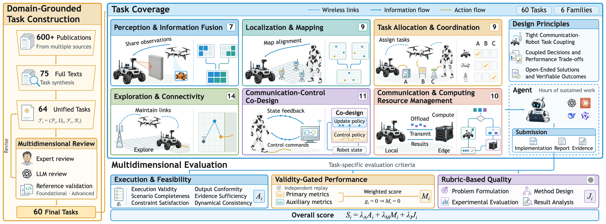

<h1 align="center">WirelessRoboBench</h1>

<h2 align="center">Evaluating Agents for Wireless Robotics</h2>

<p align="center">
  <a href="https://github.com/ygyang11/WirelessRoboAgent"></a>
  <a href="pyproject.toml"></a>
  <a href="LICENSE"></a>
</p>

WirelessRoboBench is an agent benchmark with execution-grounded multidimensional
evaluation across **60 open-ended tasks spanning six families**, presented in
*Agentic AI and Benchmarking for Intelligent Wireless Robotics*.
We develop **Arktor-Bench-SelfEvolution** to connect agent benchmarking with
evidence-driven refinement, bringing task execution, evaluation, and diagnosis
into a unified framework.

## Benchmark

[](assets/benchmark.png)

Tasks preserve communication–robotics interactions, coupled decisions, and
performance trade-offs. They specify requirements while leaving solutions
open-ended, requiring executable implementations and verifiable result evidence.

Browse the [task pack](packs/wireless_robot/) for self-contained task
specifications and executable graders.

## Evaluation

Evaluation combines automatic checks and independent replay with rubric-based
LLM assessment.

| Component | Assessment |
| --- | --- |
| **Execution and Feasibility Assessment (A)** | Check Execution Validity, Output Conformity, Scenario Completeness, Evidence Sufficiency, and Constraint Satisfaction; verify Dynamical Consistency through independent replay. |
| **Validity-Gated Performance Evaluation (M)** | Evaluate primary objectives and auxiliary trade-offs from independent replay. This component is zero when required validity checks fail. |
| **Rubric-Based Quality Assessment (J)** | Assess Problem Formulation, Method Design, Experimental Evaluation, and Result Analysis against task-specific rubrics, jointly reviewing implementations, reports, and result evidence. |

## Getting started

### Installation

Clone the repository and create the supplied Conda environment:

```bash
git clone --branch research/wireless-robo-agent \
  https://github.com/ygyang11/Arktor-Bench-SelfEvolution.git
cd Arktor-Bench-SelfEvolution
conda env create -f environment.yml
conda activate arktor-bench
python -m pip install -e ".[dev]"
```

Validate the task specifications locally, without a model API or Docker:

```bash
arktor-bench validate wireless_robot
```

### Configuration

From the repository root, create a user configuration:

```bash
mkdir -p ~/.arktor-bench
cp arktor-bench.example.yaml ~/.arktor-bench/arktor-bench.yaml
```

Set the judge's OpenAI-compatible model endpoint under `judge`:

```yaml
judge:
  model: "__SET_JUDGE_MODEL__"
  base_url: "__SET_BASE_URL__"
  api_key: "__SET_API_KEY__"
```

Configure evaluated agents under `harness`, including their models and
authentication. See [arktor-bench.example.yaml](arktor-bench.example.yaml) for
all settings. A working-directory `arktor-bench.yaml` takes priority over the
user configuration.

### Execution environment

With Docker running, build the image for WirelessRoboAgent:

```bash
docker build -f docker/Dockerfile.base \
  --build-arg ARKTOR_REF=research/wireless-robo-agent \
  -t arktor-bench:base .
```

To load the bundled research guidance, add `/opt/arktor/skills` to `skill.dirs`
in the agent configuration supplied to the container.

## Run an evaluation

From the repository root, run a single task with a configured agent:

```bash
arktor-bench run wireless_robot arktor \
  --tasks T001_uav_waypoint_delivery --trials 1
```

To evaluate all 60 tasks:

```bash
arktor-bench run wireless_robot arktor --trials 1
```

Use `arktor-bench run --help` for task selection and execution options.

## Citation

For the paper citation, see the [paper repository](https://github.com/ygyang11/WirelessRoboAgent#citation).

## License

Released under the [MIT License](LICENSE).
